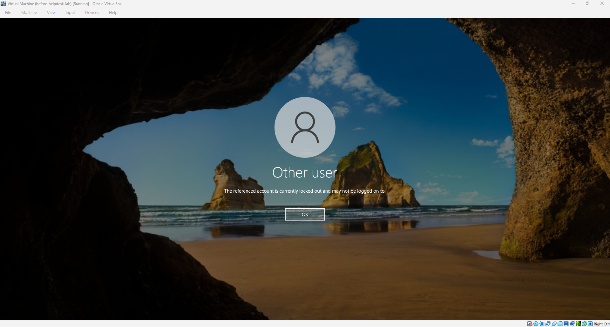
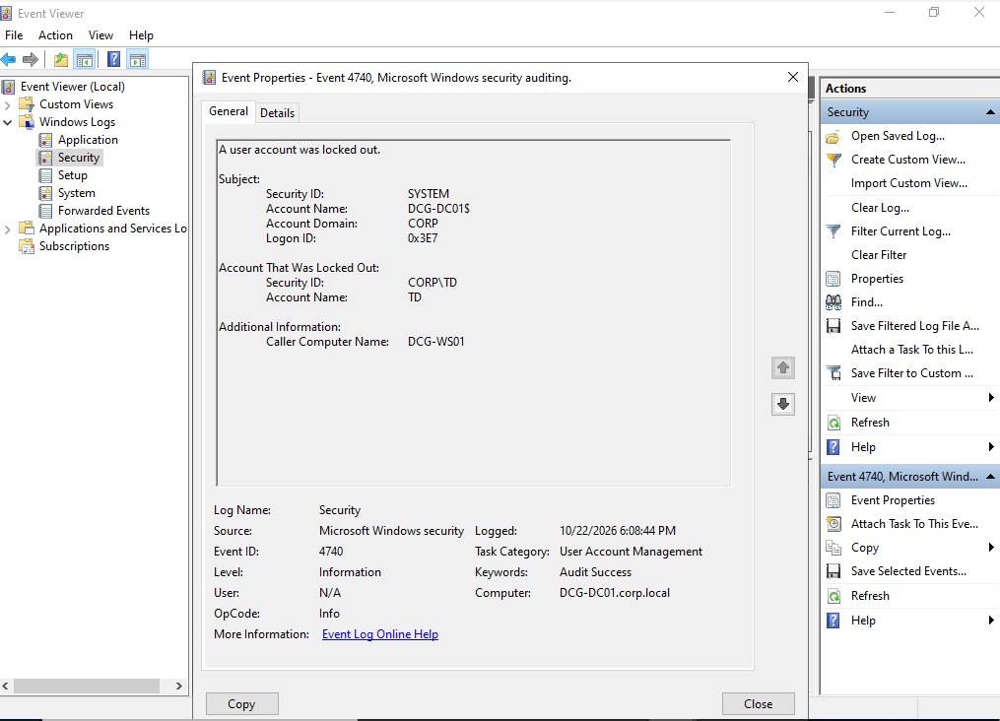
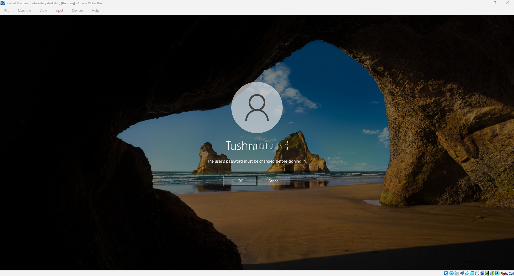
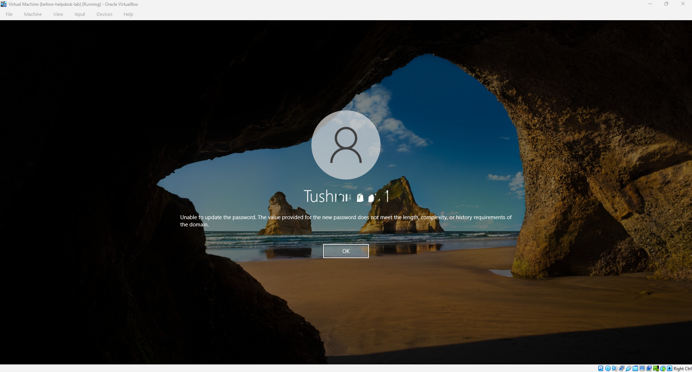

# Project 2: Account Lockouts, Password Resets, Onboarding and Offboarding

This is the second project in my IT help desk home lab series. Project 1 was about building the directory and the policies. This one is about the work a help desk does with it every day: unlocking accounts, resetting passwords, setting up new starters and shutting off access for leavers. For each task I did it on my own domain, tested the result as the user would see it, and wrote it up as a short runbook that a new colleague could follow.

## Goal

Account problems are the most common tickets on any help desk, so I wanted to be able to handle them quickly and correctly, and to explain what I was doing and why. I also wanted to practise the habits that matter as much as the technical steps: verifying who is asking before touching an account, giving out temporary passwords safely, and leaving a clear record of what was done.

## Lab environment

This project runs on the same domain as Project 1: `corp.local`, with a Windows Server 2022 domain controller (DCG-DC01) and a Windows 10 workstation (DCG-WS01) joined to it. I used two test accounts. Tushna (logon name TD) is an HR user, and I used her for the lockout and password reset tasks. Francis M (logon name francis.m) is a new Sales user, and I used him for the onboarding and offboarding tasks. The Sales team's access comes from the `Sales_Users_GG` security group and the two Sales policies from Project 1.

## The four tasks

Each task has its own runbook with the full steps and screenshots. Here is a summary of what I did and what I learned from each one.

### 1. Account lockout and unlock

I locked the HR account on purpose by entering wrong passwords at the sign-in screen until Windows refused the login, and then worked through how I'd handle it as a support person. The point that surprised me is that once an account is locked, even the correct password is refused, which is exactly what a caller will describe: "I know my password but it won't let me in."

I unlocked the account from the Account tab in Active Directory Users and Computers, and then looked for the cause in Event Viewer. Event 4740 on the domain controller shows which account was locked and, under "Caller Computer Name", which machine the bad passwords came from. In my case that was DCG-WS01, the workstation I was typing on. In a real office, that field is how you find an old phone, a saved password or a mapped drive that keeps locking someone out.

Full steps: [Runbook 1: Account lockout and unlock](runbooks/runbook-1-account-lockout.md)

### 2. Password reset

I reset the HR user's password from Active Directory Users and Computers with "User must change password at next logon" ticked, so that I only ever know the temporary password and the user chooses their own. Signing in as the user, Windows stopped them with a message saying the password must be changed before signing in.

I also tried the two mistakes users make most often when they choose a new password: typing different passwords in the two boxes, and picking one that is too weak. The weak password gives a message about length, complexity or history requirements, which is not obvious to a user, so it's useful to know how to explain it.

Full steps: [Runbook 2: Password reset](runbooks/runbook-2-password-reset.md)

### 3. Onboarding a new starter

For a new Sales starter I created the account by copying an existing Sales user, which is quicker than starting from scratch and carries over the group membership, so the new person gets the same access as their team. I set a temporary password with a forced change at first logon, and checked the summary before finishing, because it shows the OU the account will land in, and the OU decides which policies apply.

I then signed in as the new user to test the whole chain. The account worked, the user was made to set their own password, the S: drive appeared, and Control Panel was blocked by the Sales policy.

Full steps: [Runbook 3: Onboarding a new starter](runbooks/runbook-3-onboarding.md)

### 4. Offboarding a leaver

For the leaver, I disabled the account first so that nobody could sign in while I worked, removed the user from the Sales group, reset the password to a random one, and put the date, the reason and a ticket reference in the account's Description field. Then I moved the account to a Disabled Users OU. I deliberately did not delete it, because a company may need the user's files or audit trail later.

To finish, I tried to sign in as the leaver, and Windows refused with the message that the account has been disabled.

Full steps: [Runbook 4: Offboarding a leaver](runbooks/runbook-4-offboarding.md)

## What I took away from this

Verifying identity comes before everything else. A password reset or an unlock hands access to whoever is asking, so the first line of every runbook is about confirming it's really the right person. Giving access to a group instead of to individuals makes onboarding and offboarding simple, because joining or leaving a team is one membership change. A forced password change at next logon means the support person never knows the final password. Disabling an account is safer than deleting it, and writing the date and ticket reference into the account itself means the next person doesn't have to guess why it's off. Finally, the Security log gives real answers when a user is locked out, so it's worth knowing where to look.

## Runbooks

1. [Account lockout and unlock](runbooks/runbook-1-account-lockout.md)
2. [Password reset](runbooks/runbook-2-password-reset.md)
3. [Onboarding a new starter](runbooks/runbook-3-onboarding.md)
4. [Offboarding a leaver](runbooks/runbook-4-offboarding.md)

## Next

Project 3 sets up a ticketing system, where I'll log and work through tickets for tasks like these, with proper notes on what was reported, what I checked and how I fixed it.
