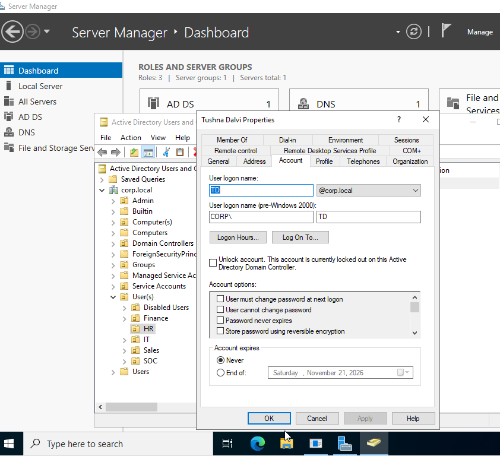
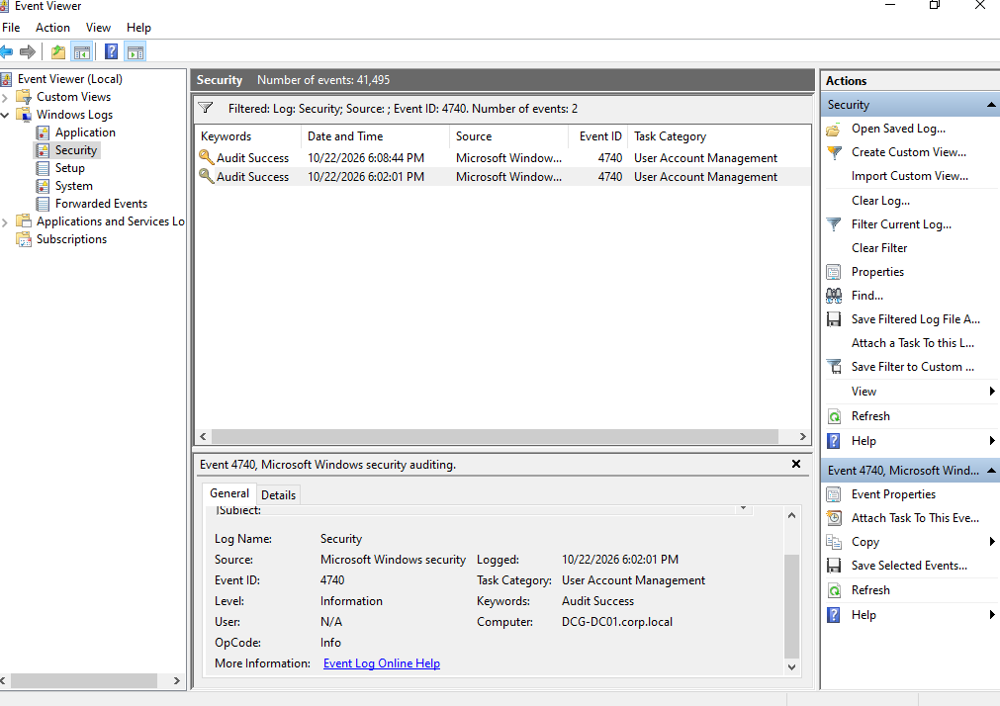

# Runbook 1: Account lockout and unlock

## Purpose

To get a user back into their account after it has been locked out, and to find out where the bad password attempts came from so it doesn't keep happening.

## When to use it

A user says they know their password but can't sign in, or they see the message "The referenced account is currently locked out and may not be logged on to." Windows locks an account after too many wrong passwords in a row, and once it is locked even the correct password is refused until the lock is cleared.

## Steps

1. Verify who is asking before you touch the account. Check their name, employee ID or department against what you have on record, or call them back on a number you already hold. If you can't confirm it's really them, don't unlock anything.

2. Confirm the lockout. Have the user try to sign in on their workstation and read out the message. A locked account shows the "currently locked out" message even when the password is right.

   

3. Unlock the account. On the domain controller, open Active Directory Users and Computers and find the user (in my lab, the account is in the HR OU). Open their Properties and go to the Account tab. If the account is locked, you'll see the unlock box with the text "This account is currently locked out on this Active Directory Domain Controller." Tick "Unlock account" and click OK.

   

   The PowerShell version does the same job. `Search-ADAccount -LockedOut` lists every locked account, and `Unlock-ADAccount -Identity username` unlocks one.

4. Find out where the bad attempts came from. On the domain controller, open Event Viewer, go to Windows Logs, Security, and filter the log for event ID 4740, which is the lockout event.

   

   Open the event and read the General tab. "Account That Was Locked Out" shows which user it was, and "Caller Computer Name" shows which machine the wrong passwords came from. Don't confuse that with the "Computer" line at the bottom of the event, which is only the domain controller that logged it.

   

5. Ask the user to sign in again with their correct password and confirm it works. If the account locks again within a few minutes, something is still sending an old password from the caller computer. Common causes are a saved password on a mapped drive, a phone or tablet with the old password in its mail app, or a scheduled task or service running as that user. Clear it on that machine.

6. Update the ticket with the time, the account, the caller computer, what you did, and that the user confirmed they could sign in.

## How I checked it worked

The account no longer showed as locked out in Active Directory Users and Computers, and the user could sign in on the workstation with their correct password.

## From my lab

I tested this with the HR user CORP\TD. After repeated wrong passwords at the sign-in screen, the account locked and the workstation refused the login. Event Viewer on DCG-DC01 logged two 4740 events on 22 October 2026, at 6:02 PM and 6:08 PM, and both named DCG-WS01 as the caller computer, which is the workstation I was typing the wrong passwords on. That matched what I did, so the check works as a way to trace a lockout back to its source.
