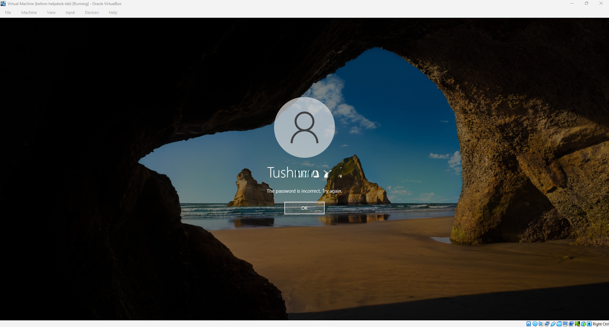

# Runbook 2: Password reset

## Purpose

To give a user a new way into their account when they've forgotten their password, in a way that leaves them the only person who knows the final password.

## When to use it

A user can't remember their password, or has been told to reset it. If they say they know the password but can't get in, check for a lockout first (see Runbook 1), because a reset won't fix a locked account unless you also unlock it.

## Steps

1. Verify who is asking before you reset anything. Check their name, employee ID or department against what you have on record, or call them back on a number you already hold. A password reset hands over access to an account, so this is the step that matters most. If you can't confirm it's really them, don't go ahead.

2. Reset the password. On the domain controller, open Active Directory Users and Computers, find the user, right-click and choose Reset Password. Type in a temporary password that meets the domain's password rules, tick "User must change password at next logon", and tick "Unlock the user's account" if the account is locked. Click OK.

3. Give the user the temporary password in a safe way, such as over the phone after you've verified them. Don't send it in a chat message or an email. Tell them they'll be asked to choose their own password the first time they sign in.

4. The user signs in with the temporary password. Windows stops them with the message "The user's password must be changed before signing in." They click OK and are asked to enter a new password and confirm it.

   

5. If they hit an error choosing the new password, it will be one of two things.

   If the two boxes don't match, Windows says "The passwords you entered did not match." They just need to type the same password in both boxes.

   

   If the password is too weak, Windows says "Unable to update the password. The value provided for the new password does not meet the length, complexity, or history requirements of the domain." This one confuses people, so explain what it means: the password is too short, or doesn't mix enough character types, or is too close to one they've used recently. Ask them to pick a longer password that they haven't used before.

   

6. If the user mistypes the temporary password, they'll see "The password is incorrect. Try again." This is worth knowing about because each wrong attempt counts towards the lockout limit. If it keeps happening, check they're typing it exactly as given before they lock themselves out.

   

7. Confirm they're in. Once the new password is accepted, the user should reach their desktop. Update the ticket with the time, the account, that you verified them, and that the reset was done with a forced change at next logon.

## How I checked it worked

The user got past the "must change password" prompt, set their own new password, and reached the desktop.

## From my lab

I tested this with the HR user Tushna (account TD). After the reset, the first sign-in was stopped with the "must be changed before signing in" message, which shows the forced change at next logon is working. I also tried the two common mistakes on purpose: entering a different password in each box, and choosing a password that was too weak for the domain's rules. Both were refused with the messages above, so I know what a user will see and how to explain it.
