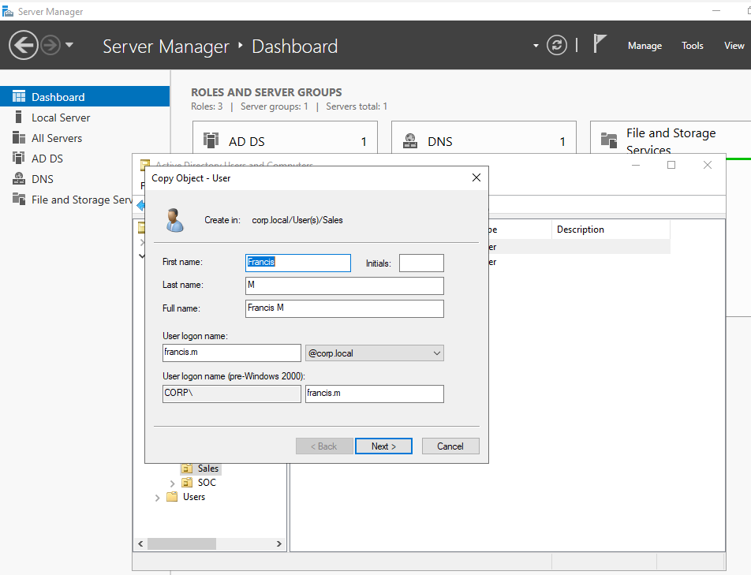
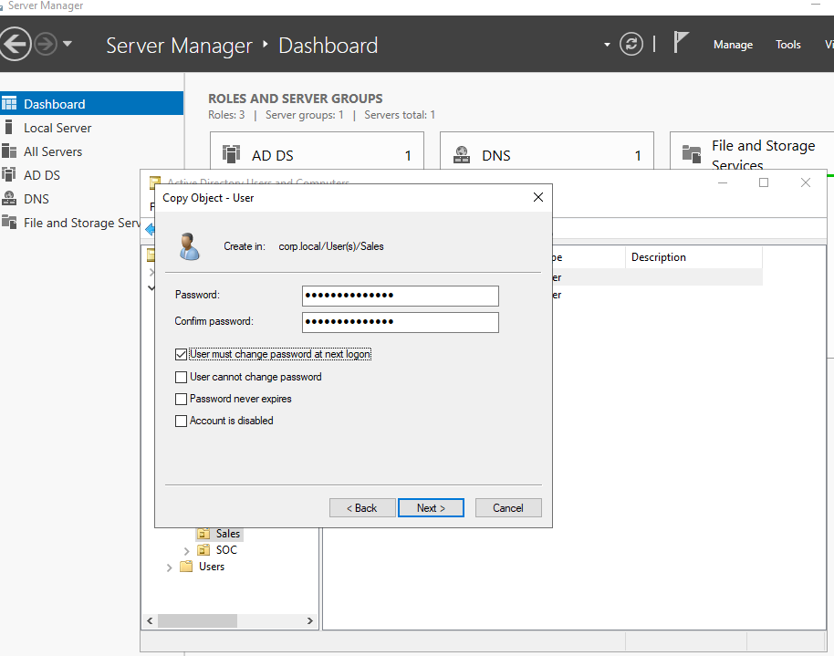
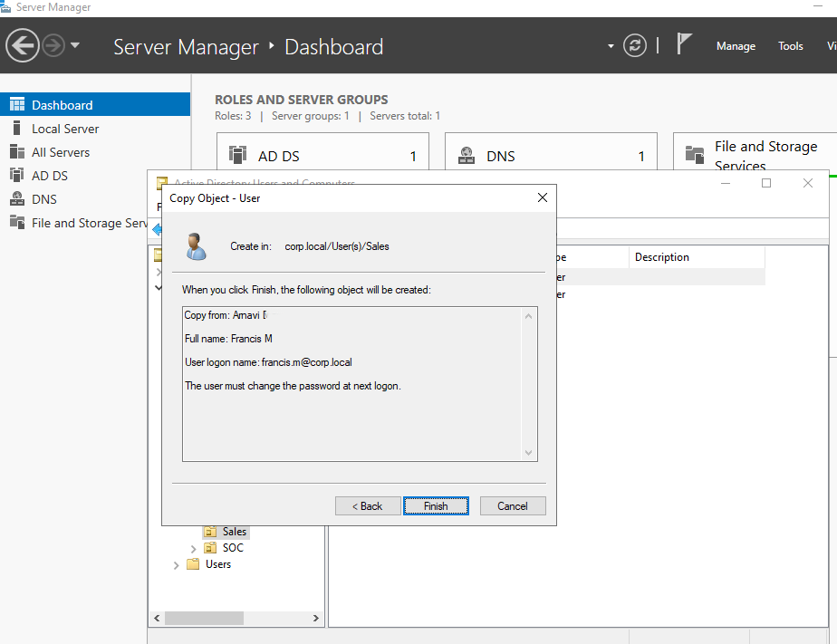
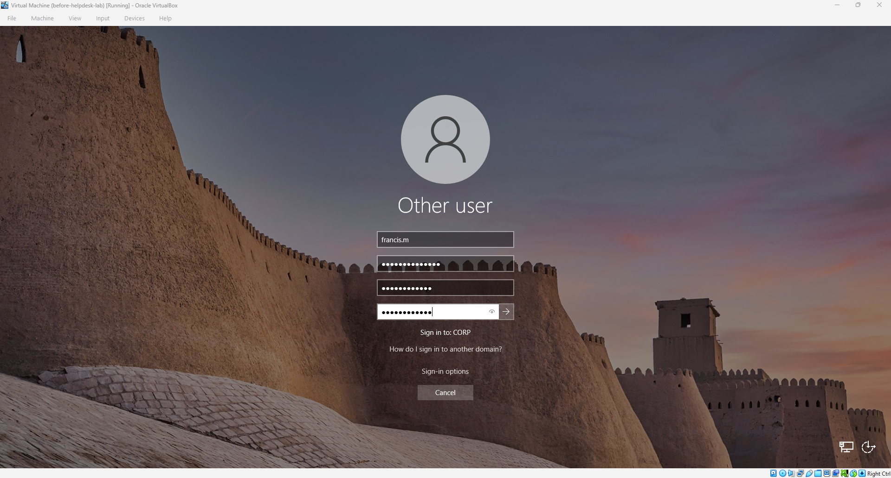
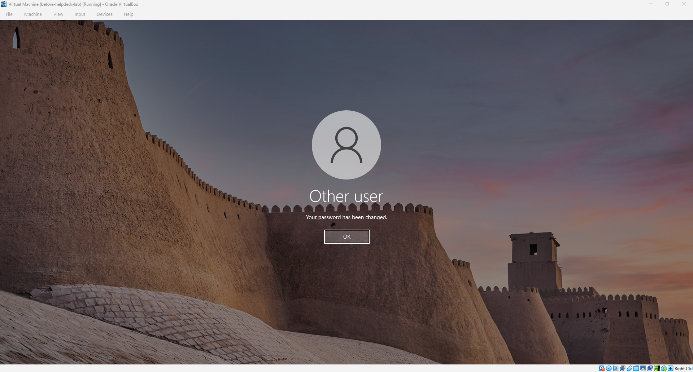
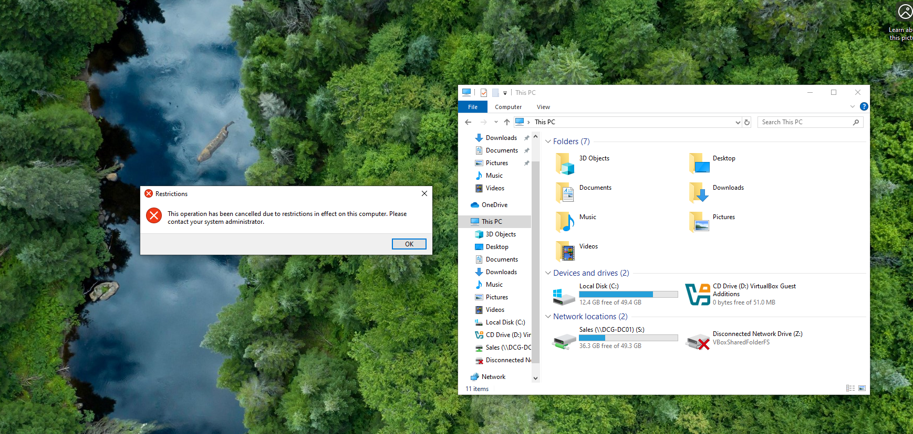

# Runbook 3: Onboarding a new starter

## Purpose

To set up a new employee's account so that on their first day they can sign in, choose their own password, and have the same access as the rest of their team.

## When to use it

A manager or HR sends a request for a new starter. In my lab, the example is a new person joining the Sales team.

## Steps

1. Get a proper request and check it's genuine. It should come from the person's manager or from HR, and it should give the new starter's full name, their department, and their start date. If anything is missing, or the request comes from someone who has no reason to be asking, go back and check before you create the account. Put the details in the ticket.

2. Start the account by copying a colleague. In Active Directory Users and Computers, go to the department's OU (for me, User(s) > Sales), right-click an existing user in the same team and choose Copy. Copying is quicker than building an account from scratch, and it carries over the group memberships, so the new starter gets the same access as their team. Fill in the first name and last name, and set the logon name following the pattern used in the company. In my lab the pattern is first name, a dot, and the last initial, so Francis M became `francis.m`.

   

3. Set a temporary password. It has to meet the domain's password rules. Tick "User must change password at next logon", and leave the other boxes unticked so the account is enabled and the password expires as normal.

   

4. Read the summary before you click Finish. It should show which account you copied from, the full name, the logon name, and the line saying the user must change the password at next logon. It also shows the OU the account will be created in, which is worth a quick check because a user created in the wrong OU won't get the right policies.

   

5. Check the group membership. Open the team's security group (here, Sales_Users_GG) and look at the Members tab to confirm the new user is listed. If they aren't, click Add and add them by hand.

   

6. Do a test sign-in on a workstation as the new user. At the sign-in screen, enter the logon name and the temporary password. Windows will ask for a new password, so enter the temporary password once, then the new password twice. After it's accepted, you'll see "Your password has been changed."

   

   

7. Once signed in, check that the user has what their team should have. In my lab, that means the S: drive appears and Control Panel is blocked, because both come from policies linked to the Sales OU. If the new user tries to open Control Panel, Windows shows a "Restrictions" message, which is the policy doing its job.

   

8. Give the temporary password to the user or their manager in a safe way, such as by phone, and not in a chat message or an email. Tell them they'll be asked to choose their own password the first time they sign in. Then update the ticket with the account name, the group they're in, and the date.

## If the S: drive doesn't appear on the first day

A brand new account sometimes signs in without the S: drive, even though the policy is applied. Here is how I tracked it down.

First, I ran `gpresult /h` as the user and opened the report. Under Settings, Preferences, Drive Maps, the S: item was listed with the winning GPO, but its result was a failure with the error code 0x800704b3. I looked the code up with `net helpmsg 1203` (the last four hex digits, 04B3, are 1203 in decimal), and it means no network provider accepted the network path. In plain terms, the drive map ran during logon before the workstation's network connection was ready. I could still open `\\DCG-DC01\Sales` by hand, which confirmed the share and the permissions were fine.

Signing out fully and signing back in fixed it, because on the second logon the network is ready in time and the drive maps normally. So for a new starter who says the drive is missing on day one, the order I'd check is: ask them to sign out and in again, then check `gpresult /h` for the Drive Maps result, then test the share path by hand.

## How I checked it worked

The new user signed in with the temporary password, was forced to set their own, and got the confirmation message. They appear in the team's security group, the S: drive is mapped, and Control Panel is blocked, which shows they have the same access and restrictions as the rest of the team.

## From my lab

I created a new Sales user, Francis M, by copying the existing Sales account for Arnavi. The new account was created in User(s) > Sales with the logon name francis.m, and it appeared in Sales_Users_GG without me adding it by hand, because the copy carried the membership over. On his first logons, the Sales policies applied, Control Panel was blocked, and the S: drive appeared after a second sign-in.
