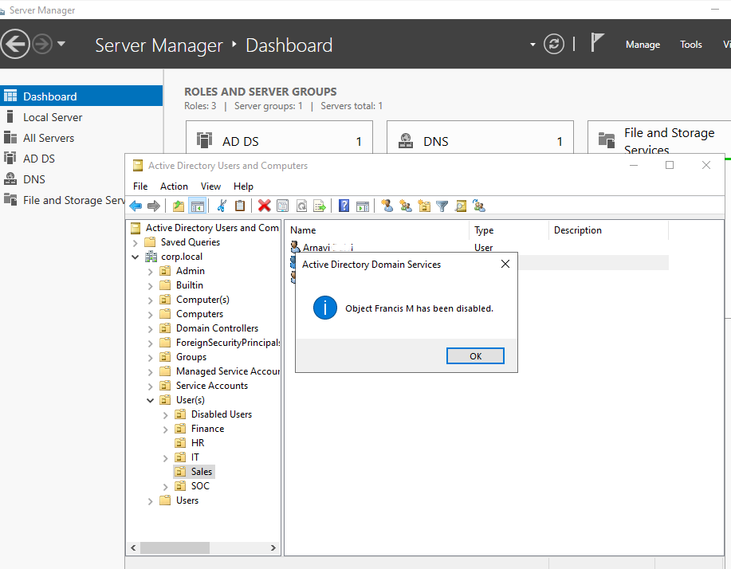
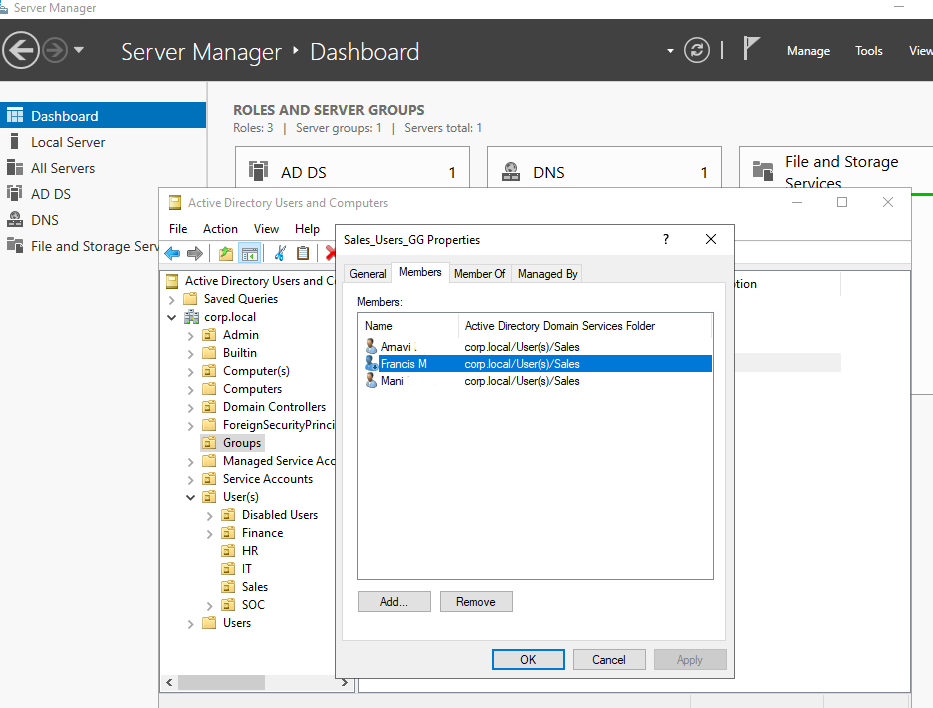
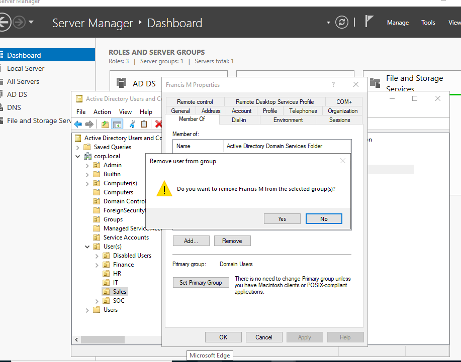
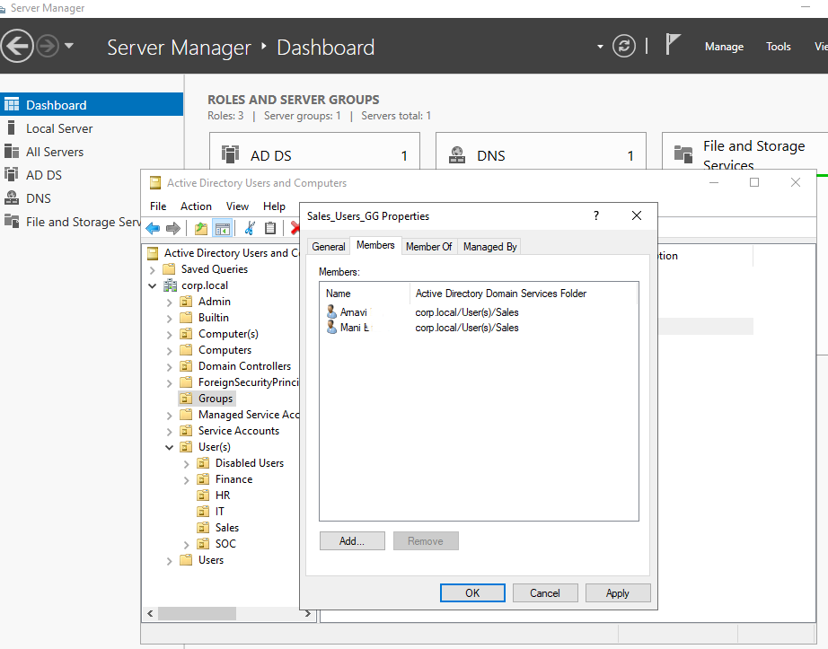
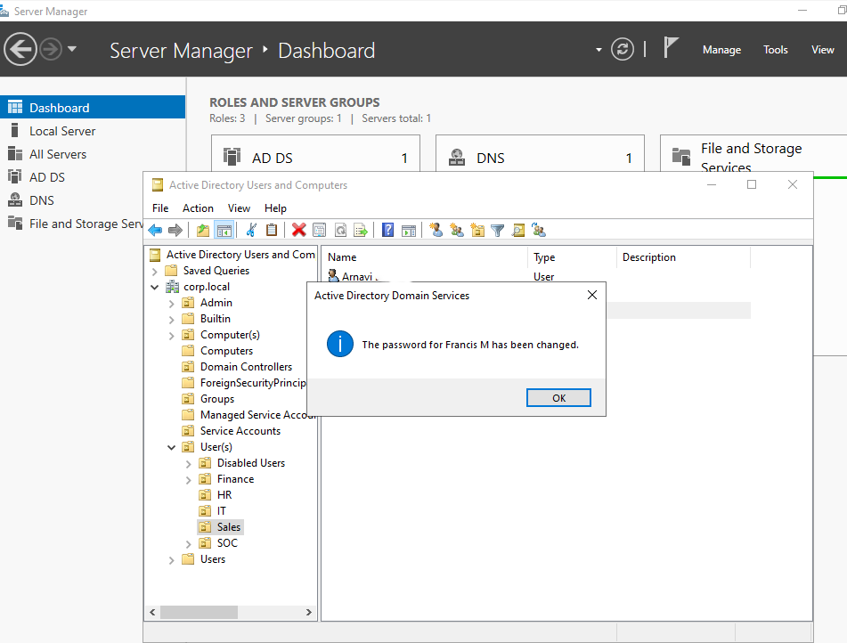
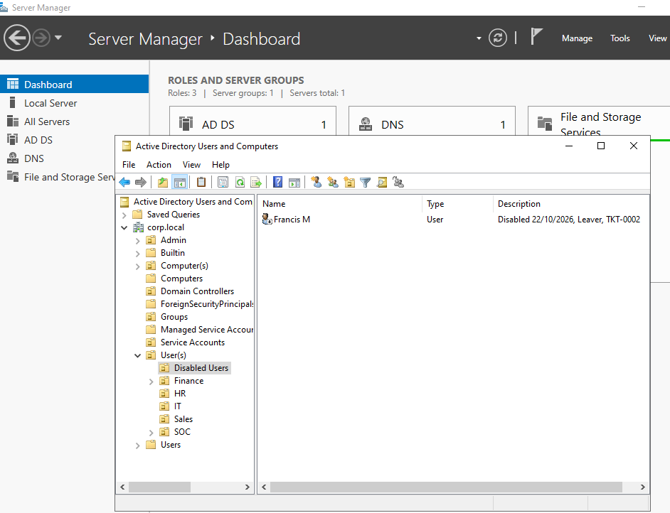
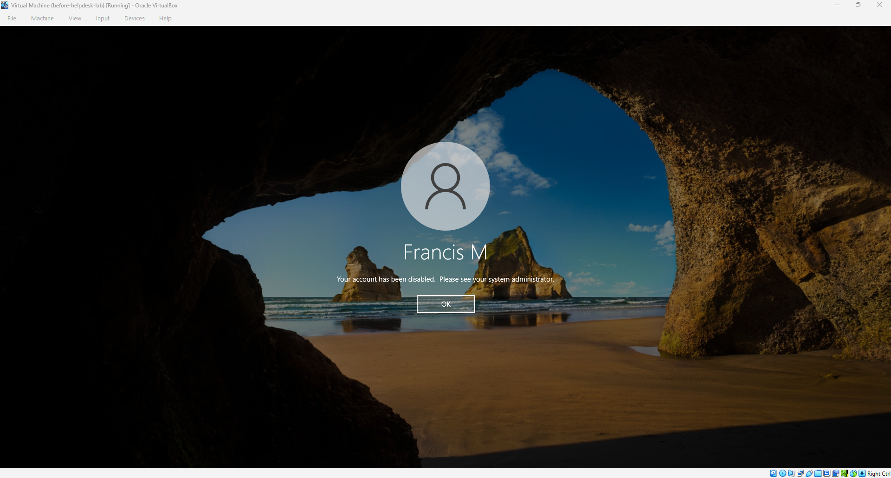

# Runbook 4: Offboarding a leaver

## Purpose

To shut off a leaver's access safely and quickly, while keeping the account itself so nothing is lost if the company needs it later.

## When to use it

HR or the manager tells you that someone is leaving, or has left. The same steps apply whether it's a planned last day or an urgent same-day exit.

## Steps

1. Get a proper request and check it's genuine. It should come from HR or the person's manager, with the person's name, their last day, and a ticket reference. Be careful with this one, because disabling the wrong account locks out someone who's still working. If you aren't sure, ask again before you act.

2. Disable the account first. In Active Directory Users and Computers, find the user, right-click and choose Disable Account. Doing this first means nobody can sign in with it while you work through the rest. Don't delete the account. The company may need the user's files, email or audit trail, so accounts are normally kept for a set period before they're removed.

   

3. Remove the user from their groups. Open the user's Properties, go to the Member Of tab, select each group and click Remove, then confirm with Yes. The Domain Users group is the primary group and stays. You can check from the other side too: before the change the user was listed in the team's group (Sales_Users_GG), and afterwards they aren't.

   

   

   

4. Reset the password to a long random one that nobody will know. This makes sure the old password is dead, even if someone knew it or wrote it down. You don't need to keep the new password. Active Directory confirms with "The password for (name) has been changed."

   

5. Record what you did in the account itself. Open the Properties and put the date, the reason and the ticket reference in the Description field. I used "Disabled 22/10/2026, Leaver, TKT-0002". Anyone who looks at the account later can see straight away why it's disabled.

6. Move the account to the Disabled Users OU, so it's out of the department and no longer picks up the team's policies. Drag it across, or right-click and choose Move.

   

7. Test that it's really shut off. Try to sign in as the user on a workstation. You should see "Your account has been disabled. Please see your system administrator."

   

8. Update the ticket with what you did and when. If the leaver had equipment, mailbox access or other systems, note who is following those up, because disabling the AD account doesn't cover everything.

## How I checked it worked

The account sits in the Disabled Users OU with the date and ticket reference in its description, it's no longer in the team's group, and a sign-in attempt is refused with the "account has been disabled" message.

## From my lab

I offboarded the test user Francis M, who I had set up in Runbook 3. I disabled the account, removed him from Sales_Users_GG, reset his password, noted "Disabled 22/10/2026, Leaver, TKT-0002" in the description, and moved him to Disabled Users. When I then tried to sign in as him on the workstation, Windows refused the login with the disabled-account message.
